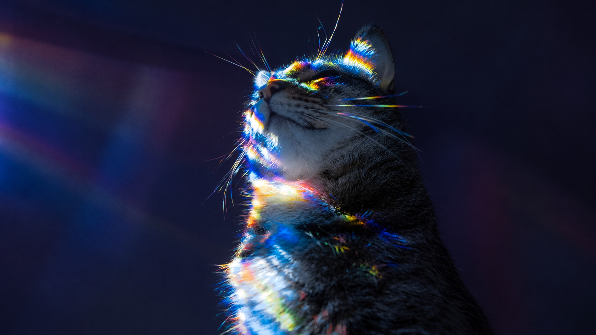

  

<h1 align="center">✦ Darlyson Gabriel ✦</h1>

  <strong>Game Dev · Godot · Experiments · Linux</strong>

<h2 align="center">
  👋 About Me
</h2>

  I'm a Game Developer focused on creating games, systems,
   
  and interactive experiences with <strong>Godot Engine</strong>.

  I enjoy experimenting with UI animation, gameplay systems,
   
  graphics and visual effects through small and focused projects.

 

<h2 align="center">
  🛠️ Technologies
</h2>

  <strong>Game Development</strong>
   
  Godot Engine · Claude AI

  <strong>Programming</strong>
   
  GDScript · Python

  <strong>Tools & Environment</strong>
   
  Git · GitHub · Linux · VScode

<h2 align="center">
  🎯 Current Focus
</h2>

<table align="center">
  <tr>
    <td align="center">💻 <strong>Expririments</strong></td>
    <td align="center">⚙️ <strong>Systems</strong></td>
    <td align="center">⭐️ <strong>Claude</strong></td>
  </tr>
</table>

  ↓
   
  <strong>Godot Engine</strong>

<h2 align="center">
  📫 Contact
</h2>

  <a href="https://github.com/DarlysonGabriel">GitHub</a>
  •
  <a href="https://darlyson-gabriel-por-0vao.bolt.host/">Website</a>
  

 

  <strong>Meow 🐱</strong>

  © 2026 Darlyson Gabriel

